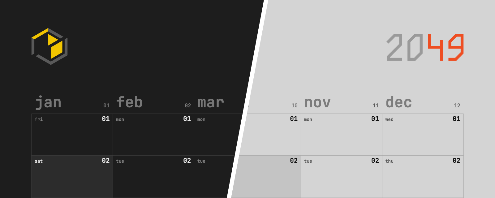

# yearly-wall-calendar



A printable year planner. Each month is a column, and each day has a cell to write in. Generate it for any year, in a dark or grey theme, in sizes A0–A3 and B1.

## Requirements

- Python 3 (standard library only)
- Google Chrome, to render the PDF and PNG
- Ghostscript, to convert the PDF to CMYK

## Usage

Make a calendar:

```bash
python3 make_calendar.py --year 2027
```

The script writes these files to `out/<year>/` for each size and theme:

| file | use |
|---|---|
| `.pdf` | print file: CMYK, exact paper size, text as outlines |
| `.svg` | editable vector file |
| `.png` | preview |

| option | default | |
|---|---|---|
| `--year` | current year | |
| `--size` | `A1` | one or more of `A0` `A1` `A2` `A3` `B1` |
| `--theme` | `both` | `dark`, `grey` or `both` |
| `--bleed` | `0` | mm to add on each side |
| `--week-start` | `mon` | `mon` or `sun` |
| `--title` | none | text to show next to the logo |
| `--rgb` | off | keep the PDF in RGB |
| `--png-scale` | `2` | preview pixels per mm |

If Ghostscript is not installed, the PDF stays in RGB.

## Print

1. Use the PDF file.
2. Select the paper size that is the same as the PDF size.
3. For a poster, do not add bleed.
4. For a mounted poster board, add 10 mm bleed with `--bleed 10`.

All greys print with black ink only. The accent prints as a fixed CMYK colour.

## Customise

Edit these values at the top of `make_calendar.py`:

- `THEMES`: the colours of each theme. `accent_cmyk` is the printed accent colour.
- `HEADER_LAYOUT`: the positions of the logo and the year.

## Font

JetBrains Mono (OFL licence), in `fonts/`.
